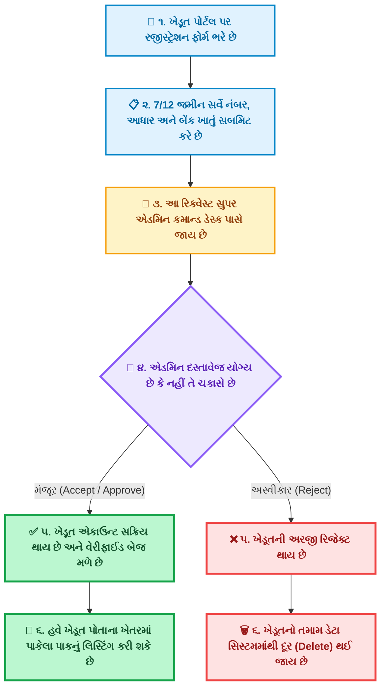
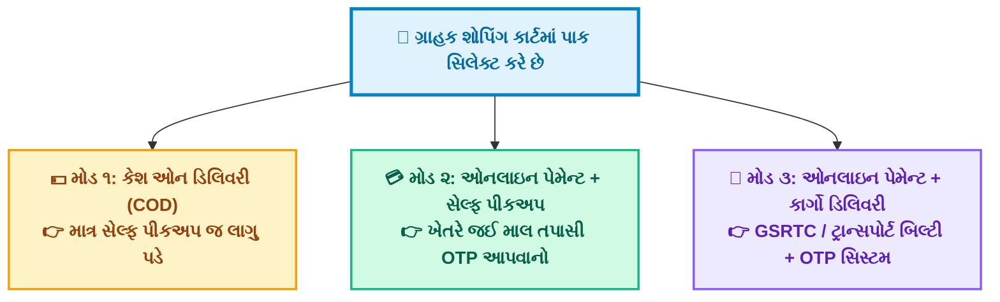
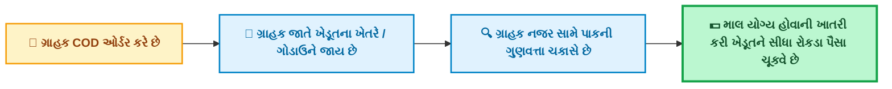
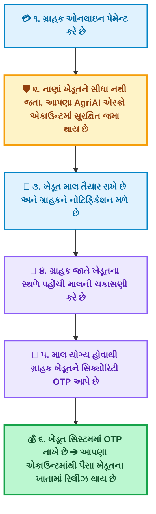
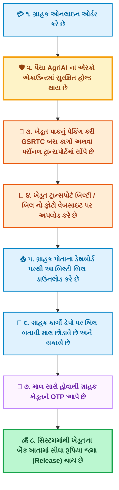
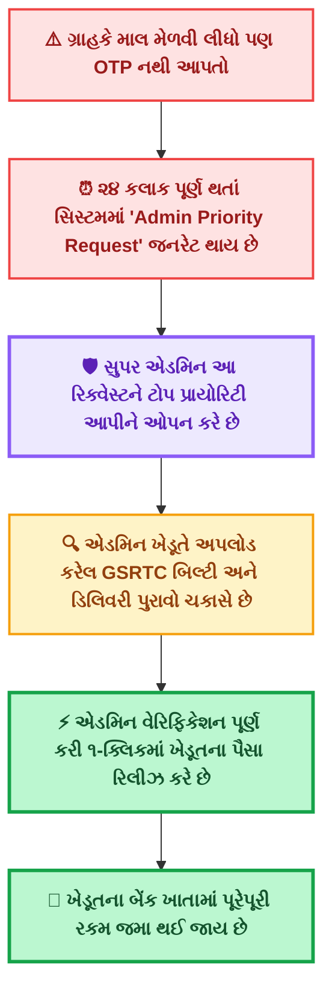
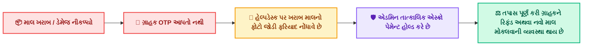

# 🌾 AgriAI: સ્માર્ટ એગ્રીકલ્ચર માર્કેટપ્લેસ અને AI ભાવ અનુમાન સિસ્ટમ
## 📑 સર્વાંગી પ્રોજેક્ટ વિગતવાર અહેવાલ (Complete Official System Architecture & Workflow Report)

> [!NOTE]
> **દસ્તાવેજ હેતુ:** આ અહેવાલમાં AgriAI પ્લેટફોર્મની વાસ્તવિક બિઝનેસ કાર્યપદ્ધતિ, ખેડૂત રજીસ્ટ્રેશન અને એડમિન વેરિફિકેશન, ગ્રાહક ખરીદીના ૩ ચોક્કસ મોડલ્સ (COD સેલ્ફ-પીકઅપ, ઓનલાઇન સેલ્ફ-પીકઅપ, અને ઓનલાઇન કાર્ગો ડિલિવરી), GSRTC / ટ્રાન્સપોર્ટ બિલ્ટી અપલોડ-ડાઉનલોડ પ્રક્રિયા, OTP ડિલિવરી કન્ફર્મેશન, ૨૪-કલાક એડમિન પેમેન્ટ સેફ્ટી નેટ, હેલ્પડેસ્ક ફરિયાદ નિવારણ અને AI મોડ્યુલ્સનું ૧૦૦% સચોટ સચિત્ર વિશ્લેષણ કરવામાં આવ્યું છે.

---

## 📌 અનુક્રમણિકા (Table of Contents)
1. [પ્રોજેક્ટ પરિચય અને મુખ્ય ઉદ્દેશ્ય](#1-પ્રોજેક્ટ-પરિચય-અને-મુખ્ય-ઉદ્દેશ્ય)
2. [ખેડૂત રજીસ્ટ્રેશન અને એડમિન ચકાસણી પ્રક્રિયા (Farmer KYC & Admin Verification)](#2-ખેડૂત-રજીસ્ટ્રેશન-અને-એડમિન-ચકાસણી-પ્રક્રિયા)
3. [પાક લિસ્ટિંગ અને માર્કેટપ્લેસ સ્ટોક મેનેજમેન્ટ](#3-પાક-લિસ્ટિંગ-અને-માર્કેટપ્લેસ-સ્ટોક-મેનેજમેન્ટ)
4. [ગ્રાહક ખરીદી અને ડિલિવરીના ૩ મુખ્ય મોડલ્સ (The 3 Core Purchase & Delivery Modes)](#4-ગ્રાહક-ખરીદી-અને-ડિલિવરીના-૩-મુખ્ય-મોડલ્સ)
   - 4.1 [મોડ ૧: કેશ ઓન ડિલિવરી (COD) + માત્ર સેલ્ફ પીકઅપ](#41-મોડ-૧-કેશ-ઓન-ડિલિવરી-cod--માત્ર-સેલ્ફ-પીકઅપ)
   - 4.2 [મોડ ૨: ઓનલાઇન પેમેન્ટ + સેલ્ફ પીકઅપ (Online + Self-Pickup with OTP)](#42-મોડ-૨-ઓનલાઇન-પેમેન્ટ--સેલ્ફ-પીકઅપ-online--self-pickup-with-otp)
   - 4.3 [મોડ ૩: ઓનલાઇન પેમેન્ટ + કાર્ગો ડિલિવરી (Online + Cargo Logistics with Bilty & OTP)](#43-મોડ-૩-ઓનલાઇન-પેમેન્ટ--કાર્ગો-ડિલિવરી-online--cargo-logistics-with-bilty--otp)
5. [૨૪-કલાક એડમિન પેમેન્ટ સેફ્ટી લૂપ (Admin Priority Escrow Release)](#5-૨૪-કલાક-એડમિન-પેમેન્ટ-સેફ્ટી-લૂપ)
6. [ખરાબ માલ / ડેમેજ ફરિયાદ નિવારણ (Damaged Goods Grievance Redressal)](#6-ખરાબ-માલ--ડેમેજ-ફરિયાદ-નિવારણ)
7. [સંપૂર્ણ સિસ્ટમ વર્કફ્લો કલરફુલ ચાર્ટ્સ (Vibrant Workflow Charts)](#7-સંપૂર્ણ-સિસ્ટમ-વર્કફ્લો-કલરફુલ-ચાર્ટ્સ)
8. [AI ક્રોપ અને પ્રાઈસ પ્રિડિક્શન મોડ્યુલ્સ](#8-ai-ક્રોપ-અને-પ્રાઈસ-પ્રિડિક્શન-મોડ્યુલ્સ)
9. [એડમિન સેન્ટ્રલ કમાન્ડ સેન્ટર અને GST ઓડિટ રિપોર્ટ્સ](#9-એડમિન-સેન્ટ્રલ-કમાન્ડ-સેન્ટર-અને-gst-ઓડિટ-રિપોર્ટ્સ)
10. [આ પ્રોજેક્ટના ક્રાંતિકારી ફાયદાઓ અને આર્થિક પ્રભાવ](#10-આ-પ્રોજેક્ટના-ક્રાંતિકારી-ફાયદાઓ-અને-આર્થિક-પ્રભાવ)

---

## 1. પ્રોજેક્ટ પરિચય અને મુખ્ય ઉદ્દેશ્ય

ગુજરાતના કૃષિ ક્ષેત્રમાં વર્ષોથી સૌથી મોટી સમસ્યા **વચેટિયાઓ (Middlemen / Dalals)** અને **અપારદર્શક બજાર ભાવો** રહ્યા છે. ખેડૂત રાત-દિવસ મહેનત કરીને પાક પકવે છે, પરંતુ નફાનો ૨૦% થી ૩૫% હિસ્સો દલાલો અને કમિશન એજન્ટો લઈ જાય છે, જ્યારે ગ્રાહકને ઊંચા ભાવે વાસી માલ મળે છે. 

**AgriAI** એ આ આખી વ્યવસ્થાને ૧૦૦% પારદર્શક, સુરક્ષિત અને ડિજિટલ બનાવી દીધી છે. આ પ્લેટફોર્મની સૌથી મોટી ખાસિયત એ છે કે:
- **ખેડૂત વેરિફિકેશન વગર કોઈ પાક લિસ્ટ કરી શકાતો નથી.**
- **ગ્રાહકના પૈસા ક્યારેય સીધા ખેડૂતને જતા નથી, પરંતુ AgriAI ના સુરક્ષિત એસ્ક્રો એકાઉન્ટમાં જમા થાય છે.**
- **માલ પહોંચ્યા પછી ગ્રાહક પોતે માલ ચકાસીને OTP આપે ત્યારે જ ખેડૂતને પૈસા મળે છે.**
- **જો ગ્રાહક જાણીજોઈને OTP ન આપે, તો ૨૪ કલાક બાદ એડમિન બિલ્ટી ચકાસીને ખેડૂતના પૈસા રિલીઝ કરી આપે છે.**

---

## 2. ખેડૂત રજીસ્ટ્રેશન અને એડમિન ચકાસણી પ્રક્રિયા

સિસ્ટમની ગુણવત્તા અને સુરક્ષા જાળવવા માટે ખેડૂતનું રજીસ્ટ્રેશન કડક ચકાસણી હેઠળ થાય છે:

### 📌 મુખ્ય મુદ્દાઓ:
1. **નોંધણી (Registration):** ખેડૂત પોતાનું પૂરું નામ, ગામ, તાલુકો, જિલ્લો, મોબાઈલ નંબર, જમીનનો 7/12 સર્વે નંબર અને બેંક ડિટેઇલ (ખાતા નંબર અને IFSC) ભરે છે.
2. **એડમિન સમીક્ષા (Admin Verification):** આ રિક્વેસ્ટ સુપર એડમિનના ડેશબોર્ડ પર જાય છે. એડમિન વિગતો ચકાસે છે.
3. **પરિણામ ૧ (જો Accept કરે):** ખેડૂતનું એકાઉન્ટ વેરિફાઈ થાય છે અને તેને પોતાના પાક લિસ્ટ કરવાની પરવાનગી મળે છે.
4. **પરિણામ ૨ (જો Reject કરે):** જો ખોટી કે શંકાસ્પદ વિગત હોય તો એડમિન રિજેક્ટ કરે છે, અને તે ખેડૂતનો ડેટા સિસ્ટમમાંથી હટાવી (Delete) દેવામાં આવે છે. જેથી કોઈ નકલી વ્યક્તિ પ્લેટફોર્મ પર આવી શકે નહીં.

---

## 3. પાક લિસ્ટિંગ અને માર્કેટપ્લેસ સ્ટોક મેનેજમેન્ટ

એડમિન દ્વારા મંજૂર થયેલ ખેડૂત જ પોતાનો પાક લિસ્ટ કરી શકે છે.

### 💡 સ્ટોક ડિસ્પ્લે વિશિષ્ટતાઓ:
- **ફોટો ઉપર ટોપ પીલ:** `● 496 Kg in Stock` (માત્ર ઉપલબ્ધ સ્ટોક).
- **પ્રાઈસ બોક્સ નીચે સ્વચ્છ વિભાજન:** `Total: 500 Kg  •  Sold: 4 Kg  •  Left: 496 Kg` (સિંગલ લાઈનમાં સ્પષ્ટ).
- **ભાવ પ્રદર્શન:** પ્રતિ કિલો ભાવ (₹/Kg) અને ૨૦ કિલો મણનો ભાવ (₹/20 Kg Maund) બંને સ્પષ્ટ દર્શાવાય છે.

---

## 4. ગ્રાહક ખરીદી અને ડિલિવરીના ૩ મુખ્ય મોડલ્સ

ગ્રાહક માર્કેટપ્લેસમાંથી પાક જોઈને ખરીદી કરે છે ત્યારે સિસ્ટમમાં ૩ ચોક્કસ મોડલ્સ કામ કરે છે:

---

### 4.1. મોડ ૧: કેશ ઓન ડિલિવરી (COD) + માત્ર સેલ્ફ પીકઅપ
જો ગ્રાહક **COD (રોકડેથી ચુકવણી)** પસંદ કરે છે, તો તેને **માત્ર Self-Pickup (જાતે ખેતરે જઈને માલ લેવો)** નો જ વિકલ્પ મળે છે.

- **કારણ:** કૃષિ પાક વજનદાર હોય છે. જો COD માં ટ્રાન્સપોર્ટમાં મોકલવામાં આવે અને ગ્રાહક માલ ન સ્વીકારે તો ખેડૂતને ભાડું અને માલનું મોટું નુકસાન થાય. તેથી COD માં ગ્રાહકે જાતે જઈને જ માલ તપાસીને રોકડા આપવાના રહે છે.

---

### 4.2. મોડ ૨: ઓનલાઇન પેમેન્ટ + સેલ્ફ પીકઅપ (Online + Self-Pickup with OTP)
જો ગ્રાહકે **ઓનલાઇન પેમેન્ટ** કર્યું હોય અને **સેલ્ફ પીકઅપ** પસંદ કર્યું હોય:

---

### 4.3. મોડ ૩: ઓનલાઇન પેમેન્ટ + કાર્ગો ડિલિવરી (Online + Cargo Logistics with Bilty & OTP)
જો ગ્રાહક ઓનલાઇન પેમેન્ટ કરી **કાર્ગો ડિલિવરી (GSRTC બસ પાર્સલ અથવા પર્સનલ ટ્રાન્સપોર્ટ)** પસંદ કરે છે:

---

## 5. ૨૪-કલાક એડમિન પેમેન્ટ સેફ્ટી લૂપ

> [!IMPORTANT]
> **ખેડૂતના નાણાંની ૧૦૦% સુરક્ષા ગેરંટી:**
> જો ગ્રાહકે માલ કાર્ગોમાંથી મેળવી લીધો હોય છતાં **જાણીજોઈને કે બેદરકારીથી ખેડૂતને OTP ન આપે**, તો સિસ્ટમમાં ખાસ પ્રોટેક્શન લૂપ મૂકવામાં આવ્યો છે:

આના કારણે કોઈપણ ગ્રાહક ખેડૂતને હેરાન કરી શકતો નથી કે તેના પૈસા રોકી શકતો નથી.

---

## 6. ખરાબ માલ / ડેમેજ ફરિયાદ નિવારણ

જો ગ્રાહક કાર્ગોમાંથી માલ મેળવે અને **માલ ખરાબ કે ડેમેજ નીકળે**, તો ગ્રાહકે ખેડૂતને OTP આપવાનો નથી:

---

## 7. સંપૂર્ણ સિસ્ટમ વર્કફ્લો કલરફુલ ચાર્ટ્સ

### ૭.૧. ખેડૂત પ્રાયોરિટી હેલ્પડેસ્ક:

- **૧-ક્લિક પેમેન્ટ ફરિયાદ:** જો બિલ્ટી અપલોડ કર્યા પછી પેમેન્ટમાં વિલંબ થાય, તો ખેડૂત પોતાના ઓર્ડરમાંથી સિલેક્ટ કરીને સીધી ફરિયાદ નોંધાવી શકે છે.
- **લાઈવ ટિકિટ ટ્રેકિંગ:** Admin તરફથી મળેલો સત્તાવાર જવાબ લીલા બોક્સમાં સીધો વાંચી શકાય છે.

### ૭.૨. બાયર કેર અને ગુણવત્તા નિવારણ (Customer Helpdesk):

- **ડેમેજ ક્લેમ ટિકિટ:** જો પાક ખરાબ નીકળે કે વજન ઓછું હોય તો અનબોક્સિંગ ફોટો જોડીને ૨૪ કલાકમાં એસ્ક્રો પેમેન્ટ હોલ્ડ કરાવી શકાય છે.

### ૭.૩. જાહેર માર્ગદર્શન અને સહાય (Public Guest Helpdesk):

- નવા ખેડૂતનું રજીસ્ટ્રેશન, બાયર પ્રોટેક્શન, અને ટોલ-ફ્રી હેલ્પલાઈન (1800-180-1551) ની સીધી સુવિધા.

---

## 8. AI ક્રોપ અને પ્રાઈસ પ્રિડિક્શન મોડ્યુલ્સ

- **AI Price Predictor (કિંમત અનુમાન):** ૨૪+ ગુજરાતના પાકો (ઘઉં, કપાસ, જીરું, મગફળી, વરિયાળી, રાયડો, ડુંગળી વગેરે) માટે આગામી ૩૦-૪૫ દિવસના APMC મંડી ભાવ, સરકારી ટેકાનો ભાવ (MSP 2025-26), મોડલ એક્યુરેસી અને અંદાજિત કમાણી દર્શાવે છે.
- **AI Crop Predictor (પાક ભલામણ):** જમીનમાં N, P, K ઘટકો, તાપમાન, ભેજ અને વરસાદનું વિશ્લેષણ કરી સૌથી વધુ ઉપજ આપતો પાક સૂચવે છે.

---

## 9. એડમિન સેન્ટ્રલ કમાન્ડ સેન્ટર અને GST ઓડિટ રિપોર્ટ્સ

```mermaid
graph TD
    classDef adminRoot fill:#006653,stroke:#047857,stroke-width:3px,color:#ffffff,font-weight:bold;
    classDef kpiTab fill:#e0f2fe,stroke:#0284c7,stroke-width:2px,color:#0369a1,font-weight:bold;
    classDef kycTab fill:#fef3c7,stroke:#f59e0b,stroke-width:2px,color:#92400e,font-weight:bold;
    classDef escrowTab fill:#d1fae5,stroke:#10b981,stroke-width:2px,color:#065f46,font-weight:bold;
    classDef cropTab fill:#fdf4ff,stroke:#c084fc,stroke-width:2px,color:#6b21a8,font-weight:bold;
    classDef orderTab fill:#e0e7ff,stroke:#6366f1,stroke-width:2px,color:#3730a3,font-weight:bold;
    classDef aiTab fill:#cffafe,stroke:#06b6d4,stroke-width:2px,color:#155e75,font-weight:bold;
    classDef reportTab fill:#fed7aa,stroke:#f97316,stroke-width:2px,color:#7c2d12,font-weight:bold;
    classDef helpTab fill:#fee2e2,stroke:#ef4444,stroke-width:2px,color:#991b1b,font-weight:bold;

    ADM["🛡️ સર્વોચ્ચ એડમિન કમાન્ડ સેન્ટર (Super Admin)"]:::adminRoot
    
    ADM --> T1["📊 ૧. એક્ઝિક્યુટિવ KPI ડેશબોર્ડ<br>(કુલ ટ્રેડિંગ, સક્રિય ખેડૂતો, લાઈવ ઓર્ડર્સ)"]:::kpiTab
    ADM --> T2["📋 ૨. ખેડૂત અને યુઝર મેનેજમેન્ટ<br>(7/12 દસ્તાવેજ અને બેંક KYC મંજૂરી / રદ્દીકરણ)"]:::kycTab
    ADM --> T3["💰 ૩. એસ્ક્રો અને બિલ્ટી પેઆઉટ્સ<br>(૨૪-કલાક ઓવરરાઈડ & બેંક ટ્રાન્સફર)"]:::escrowTab
    ADM --> T4["🌾 ૪. પાક અને કેટેગરી નિયંત્રણ<br>(પાક મંજૂરી, ભાવ મોડરેશન & સ્ટોક)"]:::cropTab
    ADM --> T5["🧾 ૫. ઓર્ડર્સ અને લાઈવ ટ્રાન્ઝેક્શન્સ<br>(દરેક સોદાનું ડિજિટલ ઓડિટ ટ્રેલ)"]:::orderTab
    ADM --> T6["🤖 ૬. AI અને APMC ઇન્ટેલિજન્સ<br>(Agmarknet API ડેટા & મોડલ મોનિટરિંગ)"]:::aiTab
    ADM --> T7["📑 ૭. સ્ટ્રેટેજિક બિઝનેસ રિપોર્ટ્સ<br>(P&L નફો, CA GST ફાઈલિંગ, બેંક NEFT શીટ)"]:::reportTab
    ADM --> T8["🎧 ૮. સેન્ટ્રલ હેલ્પડેસ્ક અને ગ્રીવન્સ<br>(ખેડૂત પેમેન્ટ અને ગ્રાહક વિવાદ નિવારણ)"]:::helpTab
```

---

## 10. આ પ્રોજેક્ટના ક્રાંતિકારી ફાયદાઓ અને આર્થિક પ્રભાવ

### 🌾 ૧. ખેડૂતો માટે ફાયદા:
- **ખોટા વેરિફિકેશન વગર સુરક્ષા:** માત્ર સાચા ખેડૂતો જ જોડાઈ શકે છે.
- **૦% કમિશન (No Middlemen):** વચેટિયા વગર સીધા ગ્રાહકને વેચવાથી ખેડૂતને ૨૦% થી ૩૫% વધુ આવક મળે છે.
- **પેમેન્ટ ડૂબવાની શૂન્ય સંભાવના:** ઓનલાઇન પેમેન્ટમાં પૈસા પહેલેથી જ એસ્ક્રોમાં જમા થઈ ગયેલા હોય છે.
- **૨૪-કલાક સેફ્ટી નેટ:** જો ગ્રાહક માલ લીધા પછી OTP ન આપે, તો પણ એડમિન બિલ્ટી ચકાસીને ખેડૂતના ખાતામાં રૂપિયા જમા કરી આપે છે.

### 🛒 ૨. ગ્રાહકો માટે ફાયદા:
- **ખેતર-તાજો પાક:** સીધો ખેડૂતના ખેતરમાંથી શુદ્ધ પાક મળે છે.
- **સંપૂર્ણ સુરક્ષા:** જ્યાં સુધી માલ ચકાસીને પોતે OTP ન આપે ત્યાં સુધી પૈસા ખેડૂતને જતા નથી.
- **ખરાબ માલ પર રિફંડ:** ડેમેજ માલ નીકળે તો ફોટો પાડીને તરત જ ફરિયાદ કરી શકે છે.
- **COD સુવિધા:** જાતે ખેતરે જઈને માલ તપાસીને રોકડા આપવાની સંપૂર્ણ છૂટ.

---

> [!TIP]
> **નિષ્કર્ષ:** AgriAI એ સામાન્ય ઈ-કોમર્સ સાઈટ નથી, પરંતુ ગુજરાતના ખેડૂતો અને ગ્રાહકો બંનેના હિતોનું રક્ષણ કરતું એક **સંપૂર્ણ, સુરક્ષિત અને અતિ-આધુનિક ડિજિટલ એગ્રીકલ્ચર પ્લેટફોર્મ** છે.
